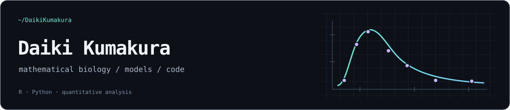

  

  <samp>
    <a href="https://daikikumakura.github.io/profile.html">profile</a> &nbsp;·&nbsp;
    <a href="https://daikikumakura.github.io/writing.html">writing</a> &nbsp;·&nbsp;
    <a href="https://daikikumakura.github.io/software.html">software</a> &nbsp;·&nbsp;
    <a href="https://daikikumakura.github.io/reference.html">glossary</a> &nbsp;·&nbsp;
    <a href="https://www.linkedin.com/in/daiki-kumakura-6b68a743a/">linkedin</a>
  </samp>

### About

I'm Daiki Kumakura, a mathematical biologist and bioinformatics researcher with a Ph.D. in Life Science from Hokkaido University.

I work with dynamic models and quantitative data analysis. My current interests include PK/PD, pharmacometrics, and what data can — and cannot — tell us about a model.

<samp>R &nbsp;/&nbsp; Python &nbsp;/&nbsp; ODEs &nbsp;/&nbsp; statistical modeling &nbsp;/&nbsp; reproducible analysis</samp>

### Selected projects

| Project | What it does |
| :--- | :--- |
| [**pkident**](https://github.com/DaikiKumakura/pkident) | Structural and practical identifiability for PK/PD ODE models. R package, in development. |
| [**rsemflow**](https://github.com/DaikiKumakura/rsemflow) | Downstream bulk RNA-seq analysis of RSEM gene-level results as TSV tables. R package and command-line tool. |
| [**retiaudit**](https://github.com/DaikiKumakura/retiaudit) | Inspect Python selection hints for reticulate without starting Python. R package. |
| [**bulkdeconv**](https://github.com/DaikiKumakura/bulkdeconv) | Estimate cell-type composition or abundance from human and mouse tumor bulk RNA-seq. R package. |
| [**rsemverse**](https://github.com/DaikiKumakura/rsemverse) | Convert RSEM gene-level results into gene-by-sample count or TPM tables. R package. |
| [**CRiSM**](https://github.com/DaikiKumakura/CRiSM) | Concatenated ribosomal marker sequences for phylogenetic analysis. Python prototype. |
| [**RLR_transform**](https://github.com/DaikiKumakura/RLR_transform) | Research scripts for compositional time series and Convergent Cross Mapping. |
| [**ShotgunMetagenomics**](https://github.com/DaikiKumakura/ShotgunMetagenomics) | Container-based scripts for read processing and functional profiling. |

See [R-universe](https://daikikumakura.r-universe.dev) for available R package builds and installation commands. The [software page](https://daikikumakura.github.io/software.html) links to documentation and related analyses. Each package has a Zenodo DOI (listed on its software page) and a `CITATION.cff` for citation.

### Glossary

[Pharmacometrics glossary and tools](https://daikikumakura.github.io/reference.html): short, sourced definitions (identifiability, shrinkage, exposure, AUPRC and more) with calculators.

### Notes & analyses

[Research articles and reproducible analyses](https://daikikumakura.github.io/writing.html) on public data, model estimation, diagnostics, uncertainty, and the limits of a conclusion. For example:

- [When does individual information improve PK/PD prediction?](https://daikikumakura.github.io/writing/warfarin-pkpd.html) — warfarin PK/PD reanalysis
- [Reimplementing a published mosunetuzumab population PK model](https://daikikumakura.github.io/writing/mosunetuzumab-public-pk-en.html) — step-up dosing exposure
- [Can matching average exposure alone set the tarlatamab dosing interval?](https://daikikumakura.github.io/writing/tcell-engager-regimen-design-en.html) — population PK simulation
- [Do early tumor measurements improve prediction of subsequent survival?](https://daikikumakura.github.io/writing/tumor-dynamics-survival.html) — landmark analysis
- [Capivasertib rest-day placement at the same weekly dose](https://daikikumakura.github.io/writing/capivasertib-rest-schedule-en.html) — public population PK simulation
- [Does equal dose intensity imply equal Dato-DXd exposure?](https://daikikumakura.github.io/writing/dato-dxd-dose-intensity-en.html) — dose intensity versus exposure
- [Gemcitabine infusion duration: plasma AUC and intracellular exposure](https://daikikumakura.github.io/writing/gemcitabine-infusion-en.html) — infusion regimen comparison

All analyses by topic: [population PK, PK/PD, dose selection, tumor dynamics and immune biomarkers](https://daikikumakura.github.io/profile.html#selected-analyses).

<samp><a href="https://daikikumakura.github.io/">daikikumakura.github.io ↗</a></samp>

