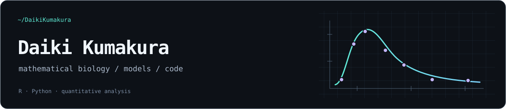

  

  <samp>
    <a href="https://daikikumakura.github.io/profile.html">profile</a> &nbsp;·&nbsp;
    <a href="https://daikikumakura.github.io/writing.html">writing</a> &nbsp;·&nbsp;
    <a href="https://daikikumakura.github.io/software.html">software</a> &nbsp;·&nbsp;
    <a href="https://www.linkedin.com/in/daiki-kumakura-6b68a743a/">linkedin</a>
  </samp>

### About

I'm Daiki Kumakura, a mathematical biologist and bioinformatics researcher with a Ph.D. in Life Science from Hokkaido University.

I work with dynamic models and quantitative data analysis. My current interests include PK/PD, pharmacometrics, and what data can — and cannot — tell us about a model.

<samp>R &nbsp;/&nbsp; Python &nbsp;/&nbsp; ODEs &nbsp;/&nbsp; statistical modeling &nbsp;/&nbsp; reproducible analysis</samp>

### Selected projects

| Project | What it does |
| :--- | :--- |
| [**pkident**](https://github.com/DaikiKumakura/pkident) | Structural and practical identifiability for PK/PD ODE models. R package, in development. |
| [**CRiSM**](https://github.com/DaikiKumakura/CRiSM) | Concatenated ribosomal marker sequences for phylogenetic analysis. Python prototype. |
| [**RLR_transform**](https://github.com/DaikiKumakura/RLR_transform) | Research scripts for compositional time series and Convergent Cross Mapping. |
| [**ShotgunMetagenomics**](https://github.com/DaikiKumakura/ShotgunMetagenomics) | Container-based scripts for read processing and functional profiling. |

### Notes & analyses

[Research articles and reproducible analyses](https://daikikumakura.github.io/writing.html) on public data, model estimation, diagnostics, uncertainty, and the limits of a conclusion.

<samp><a href="https://daikikumakura.github.io/">daikikumakura.github.io ↗</a></samp>

